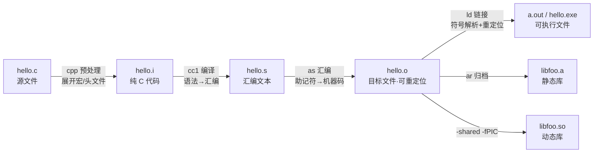

# 编译链接与库文件格式速查

> [!info] 一句话结论
> 后缀名只说明**文件扮演的角色**，不说明**文件内部的格式**。判断一个文件到底是什么，永远靠 `file` / `readelf -h` / `dumpbin /headers`，不靠后缀。
> 真正需要记住的分界线只有一条：**`.o` 是"还没拼起来的拼图块"（带重定位），`.a`/`.so`/`.exe` 是"打包方式不同的拼图盒"**。

---

## 1. 全景流水线：从 .c 到可执行文件



四个阶段各自产出一类文件，出错时的报错语气完全不同，这是排查的第一步分诊：

| 阶段 | 工具 | 典型报错 | 说明什么 |
| --- | --- | --- | --- |
| 预处理 | `cpp` | `fatal error: xxx.h: No such file` | 头文件路径 / 宏问题 |
| 编译 | `cc1` / `cc1plus` | `error: expected ';' before ...` | 语法 / 类型问题 |
| 汇编 | `as` | `Error: bad instruction` | 内联汇编 / 架构不匹配 |
| 链接 | `ld` | `undefined reference to ...` | **符号问题，不是代码问题** |

> [!tip] 只关心报错来自哪个阶段
> 前三个阶段报错都带**文件名:行号**，第四阶段（链接）只有**符号名**，没有行号。看到"没有行号"就知道是链接器在说话，去找符号而不是找代码。

---

## 2. 文件后缀总表（按角色分类）

### 2.1 源码与中间产物

| 后缀 | 含义 | 谁产生 |
| --- | --- | --- |
| `.c` `.cpp` `.cc` `.cxx` | C / C++ 源文件（`.cc`/`.cxx` 是约定，编译器一样对待） | 人写 |
| `.h` `.hpp` `.hxx` | 头文件，**不参与编译**，被 `#include` 文本展开 | 人写 |
| `.i` `.ii` | 预处理后的纯源码（`.i` 去 C，`.ii` 去 C++），`-E` 产出 | cpp |
| `.s` | 汇编源码（**小写**） | 编译器 / 人写 |
| `.S` | 汇编源码（**大写**），**会先过预处理器**（可用 `#define`、`#include`） | 人写为主 |
| `.o` | 目标文件（Unix/GCC） | as |
| `.obj` | 目标文件（MSVC / Windows） | cl |
| `.gch` `.pch` | 预编译头文件缓存，删了会自动重建 | 编译器加速用 |

> [!warning] `.s` 和 `.S` 不是大小写随便写
> 大写 `.S` 会走预处理，小写 `.s` 不会。启动文件 `startup_stm32f4xx.s` 里如果用了 `#if defined(...)`，文件名必须大写；写错会报"无法识别的汇编伪指令"。

### 2.2 库文件（最容易混的一类）

| 后缀 | 平台 | 类型 | 备注 |
| --- | --- | --- | --- |
| `.a` | Unix/Linux/嵌入式 | **静态库** | `ar` 归档，成员是一堆 `.o` |
| `.lib` | MSVC | **静态库** | 与 `.a` 等价，ar 格式装 COFF 成员 |
| `.lib` | MSVC | **导入库（import lib）** | ⚠️ **同名不同物**，见 §3.3 |
| `.so` | Linux | 动态库 | shared object |
| `.so.1` `.so.1.2.3` | Linux | 带版本号的动态库实体 | 见 §3.4 |
| `.dylib` | macOS | 动态库 | `.tbd` 是它的文本存根 |
| `.dll` | Windows | 动态库 | 必须配导入库才能链接 |
| `.dll.a` | MinGW | 导入库 | 给 `-lfoo` 用的 `.dll` 外壳 |

### 2.3 最终产物（可烧写 / 可执行）

| 后缀 | 说明 |
| --- | --- |
| `a.out` `hello` | Linux 可执行文件（无后缀，本质是 ELF） |
| `.exe` | Windows 可执行文件（PE 格式） |
| `.elf` `.axf` | **ARM 裸机可执行文件**，本质是 ELF，带符号和调试信息 |
| `.hex` `.ihx` | Intel HEX，**文本**格式，带地址记录，烧写器最爱 |
| `.bin` | 纯二进制镜像，**无地址信息**，烧写时必须手动指定起始地址 |
| `.map` | 链接映射表，看每个符号/段占了多少 flash/ram |
| `.uf2` `.dfu` | 特定烧写协议封装（拖拽烧写 / USB DFU） |

> [!tip] `.elf` / `.hex` / `.bin` 三者关系
> 同一次链接的三种出口：`.elf` 是原始产物（含调试信息），`hex`/`bin` 是它用 `objcopy` 转出来的烧写格式。
> 一句命令互转：`objcopy -O ihex in.elf out.hex` / `objcopy -O binary in.elf out.bin`。
> **调试用 `.elf`，量产烧写用 `.hex`/`.bin`**（体积小、不含路径等隐私信息）。

### 2.4 构建与辅助文件

| 后缀 | 说明 |
| --- | --- |
| `.ld` `.lds` `.ldscript` | GNU 链接脚本：定义内存布局、段放置、栈堆大小 |
| `.icf` | IAR 链接脚本（Icf 配置） |
| `.sct` | Keil/ARMCC 分散加载文件（Scatter file） |
| `.d` | Makefile 自动依赖文件（`gcc -MMD`），记录"这个 .o 依赖哪些 .h" |
| `.cmake` | CMake 模块脚本 |
| `.pdb` | MSVC 调试符号数据库（Windows） |
| `.dSYM` | macOS 的调试符号包（一个目录） |
| `.gcda` `.gcno` | 覆盖率数据（`--coverage`） |
| `.dwo` | `-gsplit-dwarf` 拆出来的独立调试信息 |

---

## 3. 库的两种形态（本篇核心）

### 3.1 静态库 vs 动态库

| 维度 | 静态库 `.a` / `.lib` | 动态库 `.so` / `.dll` / `.dylib` |
| --- | --- | --- |
| 何时参与链接 | **链接期**，代码被复制进可执行文件 | 链接期只记"我需要它"，**运行期才装载** |
| 可执行文件体积 | 大（每个用到它的程序各存一份） | 小 |
| 运行期依赖 | **无**，拷走就能跑 | 有，缺库就 `error while loading shared libraries` |
| 更新库 | 必须重新链接所有使用者 | 换 `.so` 即可（且不用改程序） |
| 内存占用 | 每个进程各一份 | 多进程**共享同一份代码页** |
| 符号冲突 | 可能出现 multiple definition | 默认全局可见，也更容易冲突 |
| 编译要求 | 无特殊 | **必须 `-fPIC`**（位置无关代码） |
| 典型场景 | 嵌入式、发布单文件 CLI、第三方专有 SDK | 系统库、插件、多程序共用的大库 |

> [!important] 一句话选型
> **目标是"拷一个文件就能跑"或"板上就那么点 flash"→ 静态库；目标是"多个程序共用 + 能单独升级"→ 动态库。**
> 嵌入式裸机几乎没有选择：**只有静态库**（没有动态装载器）。

### 3.2 静态库到底是什么

`.a` 就是 `tar` 的近亲——`ar`（archive）打包，里面是一堆 `.o`，外加一张**符号索引表**（哪个符号在哪个成员里）。

```bash
ar rcs libfoo.a a.o b.o      # 建库：r 插入 c 创建 s 建索引
ar t libfoo.a                # 列出成员
ar x libfoo.a                # 解包
nm -s libfoo.a               # 看符号索引（哪些符号、在哪个 .o 里）
ranlib libfoo.a              # 只重建索引（老式工具链建库忘了 s 时用）
```

> [!warning] 静态库的两个经典陷阱
> **① 静态库成员"按需拉取"**：链接器只把**被引用到的** `.o` 拷进去。所以"我在静态库里写了自动注册代码，怎么没执行"——因为整个成员文件都没被拉进来。
> 解法：`-Wl,--whole-archive -lfoo -Wl,--no-whole-archive`（GCC）/ `/WHOLEARCHIVE:foo.lib`（MSVC）。
> **② 静态库里的 `.o` 顺序无关，但库与库之间的顺序有关**，见 §6.1。

### 3.3 `.lib` 的双重身份（MSVC 最大坑）

Windows 上 `.lib` 可能是两种完全不同的东西，且**文件名无法区分**：

| | 静态库 `.lib` | 导入库 `.lib` |
| --- | --- | --- |
| 里面装什么 | 真正的机器码 + 数据 | **只有符号桩**，一行代码都没有 |
| 大小 | 通常几百 KB ~ 几 MB | 通常几 KB ~ 几十 KB |
| 配 `.dll` 吗 | 不需要 | **必须有对应 `.dll`**，否则链接过、运行时挂 |
| 怎么分辨 | `dumpbin /symbols x.lib` 有大量 `.text` 段 | `dumpbin /headers` 里能看到 `.idata` / 有 `__imp_` 前缀符号 |

> [!tip] 一眼分辨的小技巧
> 导入库的符号绝大多数带 `__imp_` 前缀（`__imp_foo`）。`dumpbin /symbols foo.lib | findstr __imp_` 一堆就是导入库。

### 3.4 Linux 的版本号三件套

```
libfoo.so        -> libfoo.so.1        （开发期软链，-lfoo 找它）
libfoo.so.1      -> libfoo.so.1.2.3    （soname，运行时按这个名字找）
libfoo.so.1.2.3                        （实体文件，major.minor.patch）
```

- 链接时找 `libfoo.so`（所以开发包 `-dev` 才必需，运行包 `-runtime` 只有 `.so.1`）。
- 运行时找的是**录制进可执行文件的 soname**（`.so.1`），所以补丁升级只换实体文件、重建软链即可。
- **major 号变了要重编译**，minor/patch 兼容。

```bash
readelf -d app | grep -E 'NEEDED|SONAME|RPATH|RUNPATH'   # 看依赖什么、soname 是什么
objdump -p app | grep NEEDED                            # 同上（更安全，见下）
```

> [!warning] `ldd` 有安全风险
> `ldd` 本质是"用动态装载器跑一遍并打印"，对**不可信的二进制**会真的执行它的代码。看依赖优先用 `objdump -p` 或 `readelf -d`。

---

## 4. 二进制容器格式（后缀管不了的事）

同一个 `.o`，在 Linux 上是 ELF、Windows 上是 COFF、macOS 上是 Mach-O。**跨平台不能混用**，交叉编译的本质就是换一个会输出另一种容器的工具链。

| 格式 | 用在哪 | 关键识别 |
| --- | --- | --- |
| **ELF** | Linux、Android、所有嵌入式（`.o` `.a` `.so` `.elf`） | 文件头 `\x7fELF` |
| **COFF** | MSVC 的 `.obj` | 无魔数，看 `dumpbin` |
| **PE / PE32+** | Windows `.exe` `.dll` | 开头 `MZ`，`PE\0\0` 在偏移处 |
| **Mach-O** | macOS / iOS | 支持 fat binary（一个文件装多架构） |
| **Intel HEX** | 烧写文件 | 纯 ASCII，每行以 `:` 开头 |
| **raw binary** | 烧写文件 | 无任何头，纯字节 |

### 4.1 ELF 三种姿态（用 `readelf -h` 看 `Type`）

| Type | 含义 | 例子 |
| --- | --- | --- |
| `REL`（可重定位） | 地址全是占位符，等链接器填 | `.o`、`.a` 成员 |
| `EXEC`（可执行） | 地址已固定 | 传统可执行文件 |
| `DYN`（共享对象） | 地址运行时才定 | `.so`、**PIE 可执行文件也是 DYN** |

### 4.2 段（section）速查

| 段 | 内容 | 占 flash 镜像？ | 占 RAM？ |
| --- | --- | --- | --- |
| `.text` | 机器码 | 是 | 否（XIP 时） |
| `.rodata` | `const` 常量、字符串字面量 | 是 | 否 |
| `.data` | 已初始化且**非零**的全局/静态变量 | 是（存初值） | **是** |
| `.bss` | 未初始化或初值为 0 的全局/静态变量 | **否** | **是** |
| `.init_array` `.fini_array` | C++ 全局对象构造/析构函数指针表 | 是 | 否 |
| `.ARM.exidx` | 异常展开表（C++ 异常、回溯用） | 是 | 否 |
| `.noinit` | 复位不清零的 RAM（保留重启前数据） | 否 | 是 |
| `.debug_*` | 调试信息（DWARF） | 不烧写 | 否 |

> [!tip] `.bss` 为什么不占 flash
> 因为它的初值恒为 0，编译器只需在启动代码里记"从 `__bss_start` 到 `__bss_end` 清 0"就够了，不用真的存一堆 0。
> 所以：**大数组记得初始化为 0 或干脆不初始化（进 `.bss`）；写成 `= {1}` 就进了 `.data`，白占 flash。**
> 反过来，`const uint8_t table[1024]` 放 `.rodata` 占 flash 不占 RAM，比 `uint8_t table[1024]`（占 RAM）省得多。

---

## 5. 工具速查表

| 想干什么 | Linux / 交叉编译 | Windows(MSVC) |
| --- | --- | --- |
| 这个文件是什么 | `file x` | `dumpbin /headers x` |
| 看段大小 / 总占用 | `size x`、`readelf -S x` | `dumpbin /headers` |
| 看符号表 | `nm x`、`nm -C x`（反解 C++） | `dumpbin /symbols x` |
| 看未定义符号（就差这些） | `nm -u x.o` | `dumpbin /symbols` 里 `UNDEF` |
| 反汇编 | `objdump -d x` | `dumpbin /disasm x` |
| 看动态依赖 | `readelf -d x`、`objdump -p x` | `dumpbin /dependents x` |
| 剥符号瘦身 | `strip x` | `editbin` / 链接时 `/DEBUG:NONE` |
| 格式转换 | `objcopy -O binary/ihex` | — |
| 删掉某段 | `objcopy --remove-section=.comment` | — |
| C++ 符号反解 | `c++filt _Z3fooi` | `undname` |
| 只保留被引用的段（省 flash） | 链接加 `--gc-sections` + 编译加 `-ffunction-sections -fdata-sections` | `/OPT:REF` |

> [!tip] 嵌入式最常用的三条
> ```bash
> arm-none-eabi-size -A firmware.elf          # 各段占多少，一眼看 flash/ram 是否爆
> arm-none-eabi-nm -C --size-sort firmware.elf | tail -20   # 最占地方的 20 个符号
> arm-none-eabi-objdump -h firmware.elf        # 段布局，配合 map 文件查
> ```

---

## 6. 链接期规则与踩坑

### 6.1 库的顺序（GNU ld 单遍扫描）

链接器从左往右**只扫一遍**，遇到未定义符号时，只有**它右边**的库能提供定义。所以：

```bash
# 正确：依赖者在前，被依赖者在后
gcc main.o -lfoo -lbar -lm

# 错误：bar 用到了 foo 的符号，但 foo 已在左边被扫过、不会再回来看
gcc main.o -lbar -lfoo     # -> undefined reference to 'foo_xxx'
```

循环依赖用 group 包住：

```bash
gcc main.o -Wl,--start-group -la -lb -Wl,--end-group
```

> [!tip] 排查口诀
> `undefined reference` 先别怀疑代码，先**把报错的库往后挪**、或者直接改成静态库全路径（`gcc main.o ./libfoo.a`）。顺序对了 80% 的问题消失。

### 6.2 常见链接错误对照表

| 报错 | 真实原因 | 解法 |
| --- | --- | --- |
| `undefined reference to 'xxx'` | 缺库 / 库顺序错 / 该符号根本没编进来 | 补 `-l`、调顺序、`nm` 确认符号存在 |
| `undefined reference to 'std::cout'` | **用 `gcc` 链了 C++ 目标文件** | 改用 `g++`，或补 `-lstdc++` |
| `multiple definition of 'xxx'` | 头文件里定义了变量/函数（非 `inline`/非 `static`） | 头文件只放 `extern` 声明，定义放 `.c`；C++17 `inline` 变量 |
| `relocation R_X86_64_32 ... can not be used when making a shared object; recompile with -fPIC` | 只加了 `-shared` 没加 `-fPIC` | 编译和链接**都**加 `-fPIC` |
| `error while loading shared libraries: libfoo.so.1: cannot open shared object file` | 链接过了，**运行期找不到** | 见 §6.4 |
| `LNK2019` unresolved external symbol | 同 undefined reference | 补 `.lib`、查 `extern "C"` |
| `LNK2005` already defined | 重复定义，通常是 CRT 混用（`/MT` 与 `/MD` 不一致） | 统一运行库选项 |
| `LNK4098` defaultlib 'LIBCMT' conflicts | 同上，库冲突 | 统一 `/MT` 或 `/MD` |
| `LNK1104` cannot open file 'xxx.lib' | 路径不对 / 根本没这个文件 | 检查附加库目录 |

### 6.3 C++ 的 `extern "C"`（跨语言必踩）

C++ 会做 **name mangling**（`void foo(int)` → `_Z3fooi`），C 不会。所以：

- **C 代码调 C++**，或**C++ 调 C 库**，头文件必须包 `extern "C"`。
- 写库给 C 用时，头文件标准写法：

```c
#ifdef __cplusplus
extern "C" {
#endif

int my_api(int x);

#ifdef __cplusplus
}
#endif
```

> [!warning] 症状识别
> 报 `undefined reference to 'my_api'` 而 `nm libfoo.a` 里明明有 `_Z6my_apii`（被 mangle 了）→ 就是漏了 `extern "C"`。
> 用 `nm -C` 或 `c++filt` 反解一下符号名，立刻现形。

### 6.4 运行期找不到 `.so` 的四种解法

| 方法 | 做法 | 适用 |
| --- | --- | --- |
| 环境变量 | `export LD_LIBRARY_PATH=/opt/foo/lib:$LD_LIBRARY_PATH` | 临时调试 |
| 系统配置 | 写 `/etc/ld.so.conf.d/foo.conf` 后 `ldconfig` | 系统级安装 |
| 编译期 rpath | `-Wl,-rpath,/opt/foo/lib` 或 `-Wl,-rpath,'$ORIGIN/lib'` | **随程序分发的推荐做法**（`$ORIGIN` = 可执行文件所在目录） |
| 运行时手动加载 | `dlopen("libfoo.so", RTLD_LAZY)` + `dlsym` | 插件架构 |

> [!tip] 优先级顺序
> rpath（编译进程序）→ `LD_LIBRARY_PATH` → `ld.so.cache`（`ldconfig` 生成）→ 默认路径 `/lib`、`/usr/lib`。
> 想让程序"拷到哪都能跑"，用 `$ORIGIN` 相对路径 rpath，别依赖环境变量。

### 6.5 静态链接 glibc 的坑

`-static` 全静态链 glibc 会踩：

- **NSS 失效**：`getaddrinfo`、`getpwnam` 需要运行时 `dlopen` `libnss_*.so`，全静态下会警告 `Using 'getaddrinfo' in statically linked applications requires at runtime the shared libraries`。
- 体积暴涨（几 MB）。
- 更稳的做法是 **`-static-libgcc -static-libstdc++`**：只静态链 C++ 运行库，glibc 仍然动态。这样既有"不用装 libstdc++"的便利，又不破坏 NSS。

---

## 7. 嵌入式专章（裸机与交叉编译）

### 7.1 工具链三元组：先确认你拿的是哪把

| 前缀 | 目标 | 有 OS 吗 | ABI |
| --- | --- | --- | --- |
| `arm-none-eabi-` | ARM 裸机 / RTOS | **无** | EABI，只能跑裸机 |
| `arm-linux-gnueabihf-` | ARM + Linux | 有 | **硬浮点**（hf），动态链接 |
| `arm-linux-gnueabi-` | ARM + Linux | 有 | 软浮点，老设备 |
| `aarch64-none-elf-` | ARM64 裸机 | 无 | — |

> [!warning] 两个"arm"绝对不能混
> `arm-none-eabi` 编出来的东西**不能**在 Linux 上跑（没有 syscall、没有动态装载器）；
> `arm-linux-gnueabihf` 编出来的**不能**烧进单片机（依赖 libc.so 和内核）。
> 拿错了会得到"烧进去就 HardFault"或者"在板子上 `not found`"。

### 7.2 裸机链接的完整要素

一次裸机链接 = **启动文件 + 你的代码 + 标准库 + 链接脚本**。

| 要素 | 文件 | 作用 |
| --- | --- | --- |
| 启动文件 | `startup_xxx.s`（大写 S，走预处理） | 定义中断向量表、`Reset_Handler`、调 `SystemInit` 再跳 `main` |
| 链接脚本 | `xxx.ld` / `.lds` | 声明 FLASH/RAM 起止地址、段怎么摆、栈堆多大 |
| 标准库 | `libc_nano.a`、`libm.a`、`libgcc.a` | 除零、64 位乘除、`memcpy`、`printf` |
| 系统调用桩 | `syscalls.c` / `--specs=nosys.specs` | 给 newlib 的 `_write/_sbrk` 填空实现 |

关键编译选项：

```bash
arm-none-eabi-gcc \
  -mcpu=cortex-m0plus -mthumb \
  -ffunction-sections -fdata-sections \   # 每函数/变量独立成段
  -Os \
  -T stm32.ld \                            # 链接脚本
  -Wl,--gc-sections \                      # 丢掉没人用的段（省 flash 关键）
  -Wl,-Map=firmware.map \                  # 生成 map
  --specs=nano.specs \                     # 用 newlib-nano，flash 省一半
  --specs=nosys.specs \                    # syscall 空实现，消掉 _write 未定义
  -o firmware.elf
```

> [!important] `--specs=nano.specs` 与 `--specs=nosys.specs` 区别
> `nano.specs` = **换成精简版 libc**（体积小、但 `printf` 不支持浮点，要 `-u _printf_float` 才开）。
> `nosys.specs` = **补上系统调用的空桩**（`_write` 直接返回、`_sbrk` 返回 -1）。
> 两个是不同维度，通常**一起用**。只加 nano 不加 nosys，会出现一串 `undefined reference to '_write'`。

### 7.3 裸机常见未定义符号对照表

| 缺失符号 | 谁要的 | 怎么补 |
| --- | --- | --- |
| `_start` / `Reset_Handler` | 链接器入口 | 漏了启动文件，或用 `-nostartfiles` 却没自己写入口 |
| `_write` `_read` `_close` `_lseek` `_fstat` `_isatty` | newlib（`printf` 用） | 加 `--specs=nosys.specs` 或自己写 `syscalls.c` |
| `_sbrk` | `malloc` | 同上；或干脆不用动态内存（推荐） |
| `_etext` `_edata` `_end` `__bss_start` `_estack` | 启动代码 | **链接脚本没定义**，检查 `.ld` 里的符号 |
| `__libc_init_array` | C++ 全局构造 | 加标准库，或在 `Reset_Handler` 里手动调用 |
| `__aeabi_ldivmod` 等 | 64 位除法/软浮点 | 加 `libgcc.a`（一般自动带上） |

> [!warning] C++ 在裸机上三个必关
> `-fno-exceptions`（异常要 `.ARM.exidx` + 堆）、`-fno-rtti`（RTTI 占 flash）、`-fno-threadsafe-statics`（否则局部静态变量初始化会引用 `__cxa_guard_*`）。
> 还有：**全局对象的构造函数默认不会执行**——必须在 `main` 前调用 `__libc_init_array()`，否则所有 C++ 全局对象都是未初始化状态（表现为"虚表指针是 0，一调就 HardFault"）。

### 7.4 从 `.elf` 到烧写文件

```bash
# 1. 先看占了多少（对比 MCU 的 flash/ram）
arm-none-eabi-size firmware.elf

# 2. 转烧写格式
arm-none-eabi-objcopy -O ihex   firmware.elf firmware.hex
arm-none-eabi-objcopy -O binary firmware.elf firmware.bin

# 3. 发布版剥符号（调试版千万别剥）
arm-none-eabi-objcopy --strip-debug firmware.elf firmware_release.elf
```

> [!tip] `.bin` 没有地址信息
> `.bin` 的第一个字节固定映射到链接脚本里**最低的加载地址**（通常是 flash 起始 0x08000000）。
> 如果 bootloader 要求从 0x08004000 开始，要么改链接脚本的 ORIGIN，要么用 `objcopy --change-addresses` 偏移。
> **烧 `.bin` 却"跑飞"、`.hex` 却正常，八成就是起始地址错了。**

---

## 8. 常见构建系统的产物位置对照

| 构建系统 | 目标文件 | 静态库 | 动态库 | 可执行 |
| --- | --- | --- | --- | --- |
| 手写 gcc | `*.o` | `lib*.a` | `lib*.so` | 随意 |
| Makefile 惯例 | `obj/` 或 `build/` | `lib/` | `lib/` | `bin/` |
| CMake（默认） | `CMakeFiles/<tgt>.dir/*.o` | `lib*.a` | `lib*.so` | 无后缀 |
| CMake（指定） | `build/` | `build/lib*.a` | `build/lib*.so` | `build/` |
| MSVC (VS) | `x64/Debug/*.obj` | `*.lib` | `*.dll` | `*.exe` |
| Keil MDK | `Objects/*.o` | `*.lib` | — | `Objects/*.axf` + `*.hex` |

> [!tip] 找"到底链接了哪个库"
> CMake：`cmake --build build --verbose`，看完整链接命令行；
> 或看 `build/CMakeFiles/<target>.dir/link.txt`，那里有最终 `ld` 命令的全部参数和库路径。
> 找不到符号时，这一行往往就是答案（能看到 `-L` 指向哪个目录、`-l` 到底解到了哪个文件）。

---

## 9. 一页速查（打印版）

```
源 → .i → .s → .o → 可执行/库

.a  静态库(Unix)      .lib 静态库(MSVC) / 导入库(MSVC, 只有桩)
.so 动态库(Linux)     .dll 动态库(Win)   .dylib 动态库(mac)
.elf 裸机可执行(ELF)  .hex 文本烧写      .bin 裸镜像(无地址)

静态库：链接期复制进程序，运行无依赖，嵌入式唯一选择
动态库：运行期装载，编译必须 -fPIC，多程序共享

三个高频错：
undefined reference     → 库顺序 / 漏库 / 漏 extern "C"
multiple definition     → 头文件里放了定义
cannot open .so         → 运行期路径，用 $ORIGIN rpath

嵌入式三条：
--specs=nano.specs + --specs=nosys.specs
-ffunction-sections -fdata-sections + -Wl,--gc-sections
C++ 必调 __libc_init_array() 否则全局对象不构造
```

---

## 10. 还没搞清的 / 待补

- [ ] LTO（`-flto`）对静态库的影响：`.a` 里存的是 GIMPLE 中间表示，`ar`/`nm` 看起来会"没有符号"，实际是要在最终链接时才编——遇到"LTO 库 nm 看不到符号"别慌。
- [ ] 符号可见性：`-fvisibility=hidden` + `__attribute__((visibility("default")))` 的实践（GCC 默认全导出，与 MSVC 默认不导出相反）。
- [ ] 符号版本（`.symver` / version script）在有 ABI 兼容要求时的写法。
- [ ] `dlopen` 插件架构在自己项目里的可行性（参考端侧 AI 那套运行时加载模型的路子）。
