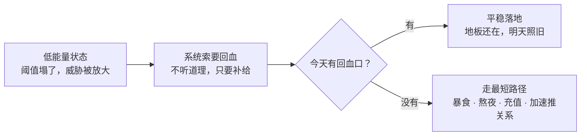

# 平静之后 · 欲望、真诚与方案

> **一句话核心：平静是地板，不是屋顶。地板建好之后，往上面放什么，才是真问题。**
> 本篇承接 [[12.情绪治理总纲·三环可控与干净的强]] 第九、十节（方向与代价），处理"方向定了之后"的四件事：**欲望怎么摆、真诚怎么用、方案怎么落、燃料从哪来**。

> 上游：[[12.情绪治理总纲·三环可控与干净的强]] 第九节（地板不是屋顶）、第十节（无奈三类 / 绝对能力 vs 相对排名）。

---

## 一、欲望的入口：老子削的是"门"，不是"欲"

《道德经》第三章：「不尚贤，使民不争；不贵难得之货，使民不为盗；**不见可欲，使民心不乱**。」

- **受力方向**：这是对**治理者**说的——不要制造让人眼红的东西。"不见"是一个**动作**，施动者是**环境**，不是让你把欲望掐死。
- **老子削的是"入口"，不是"欲望"。** 链路：`可欲暴露 → 心生贪 / 心乱 → 掠夺或内耗`；干预点标在**第一环**。
- **补上另一半（本人观察）**：可欲**不需要被正面看见**才能进来——**人一闲，注意力空出来，可欲自己会找上门**。这不是道德问题，是**注意力守恒**。
- 因此"不见可欲"的正确执行方式是 **占用**，不是闭眼：
  - **占用**（填满日程 / 环境设计）→ 不需要用力，可持续。
  - **戒 / 压制** → 属于前面说的**压抑**（需持续用力，一松懈就反弹）。

## 二、幻想的结构：相对地位，不是需求

- 自陈："想与天下间的美女发生关系，若有能力必会去做，只是没能力。"
- **不以欲望本身定罪**：欲望的产生不可控，投入可控（同"情绪的产生不可控，续编可控"）。**道德只结算在"做了"上，不结算在"想过"上。**
- **但要看穿幻想的形状**："天下间的美女"是**相对地位幻想**——要的不是那个人，是"**我可以**"这三个字。它落在第十节说的**相对排名**：零和、被阈值适应吃干净、**不属于绝对能力扩张**。做到了不会变强，只获得一次会归零的验证，于是需要下一次——**跑步机**。
- **"没有这个能力"的现实作用反而是保护**：它让你没走上那条赛道。

## 三、真诚的成本：装 / 分寸 / 真

**起点（本人观察）**："人生一辈子本来就累，大多时候不需要装——**特别是面对需要或准备长期相处的人**，一直装很累。"

- **精确化**：装的收益**即时**（第一印象 / 被接受），成本**持续**（维护 + 暴露风险）→ 装成本 ≈ **相处时长 × 被看穿概率**。**长期关系里"不装"不是道德要求，是成本最优解（负期望值）。**
- **核心类比**：**装 = 关系版的压抑**（需持续用力，一松懈就露）；不装则不需要维持 → 省下的是**可再生的能量**。
- **三种"看起来像装"的呈现——只有第一种该省：**

| 型号 | 做什么 | 成本 | 判 |
|---|---|---|---|
| **装** | 伪造一个我**没有**的 | 随相处时长递增 | **该省** |
| **分寸** | 同一人格，按距离调节 | 恒定，可长期 | **别省** |
| **真** | 呈现真实的自己 | 近零，可再生 | **目标** |

- **三条边界**：
  1. **分寸别一起省。** 分寸是**同一个人格按距离调节呈现**，不是伪装。省掉它换来的不是真诚，是冒犯。
  2. **不装 ≠ 不修。** 装 = 伪造一个**没有**的（不可持续，赢了也是输——被爱的是那个假人）；修 = 真实地**长**出一个（可持续）。正确组合是 **"不装，但要长"**。
  3. **不装 ≠ 无边界。** `7` 篇那三层边界仍在。"我说话就这样"不是真诚，是不设界。

## 四、君子有三变：子夏给"分寸"下的定义

《论语 · 子张》19.9 **子夏曰**：「君子有三變：望之儼然，即之也溫，聽其言也厲。」

- 朱熹《集注》：「儼然者，**貌之莊**。溫者，**色之和**。厲者，**辭之確**。」→ 三个通道：**看（貌）/ 近（色）/ 听（辞）**；距离越近，读到的人格层次越深。
- 程颐：「他人儼然則不溫，溫則不厲，**惟孔子全之**。」→ 难点不在三样都有，在三样**同时成立**。
- 谢良佐：「**此非有意於變，蓋並行而不相悖也，如良玉溫潤而栗然。**」→ 同一块玉，温润与坚栗是**同一属性**。
- 张居正《直解》：「君子豈有意而為之者哉？……人之得於瞻仰聽聞，見其變動不拘若此耳。」→ **变在观者，不在君子。**
- **这就是"装"的反定义**：装是**有意于变**（看人下菜、按对象调整以迎合）；三变是**非有意于变**。
- 交叉印证：《述而》「**子溫而厲，威而不猛，恭而安**」——从"一体"看，与三变（从"距离"看）是同一件事。
- **缺一即偏**：只俨然则冷（拒人），只温则滥（无原则），只厉则刻（伤人）。故**不可"只保留温和"**。

## 五、诚：不装是横向一致，不是纵向恒定

**本人定义**：不装 = 大多时候表现**当前**最真实的自己；后续优化之后，**这个自己也会发生变化**。

- 这正是《中庸》「**誠則形，形則著，著則明，明則動，動則變，變則化**」的结构——**诚不是变化的对立面，诚是变化的发动机**。（原句主语是至诚者化育万物，用回自己身上结构一致。）
- **精确化**：**不装 = 横向一致（此刻内外一致），不是纵向恒定（永远不变）。** 二者一混，"真"就退化为**僵化**——把"我就是这样的人"当真诚，其实是拿"不变"豁免成长。
- **"大多时候"三字留得准**：不是打折，是给**分寸**留了位置。
- **警告：优化 ≠ 否认当下的自己。** 若把"当下的我"当成**一份待删除的草稿**，那还是装（对未来的自己装），且会重开自我攻击的陷阱（"我怎么还没优化好"）。

| 可以优化 | 慎言"优化" |
|---|---|
| 能力、习惯、表达方式、外形、见识 | 价值排序、好恶、性格倾向 |
| 长在**上面**，越加越厚 | 这些是**你**，改掉不是成长，是替换 |

> 真不是"我一直这样"，是"**我此刻这样，而且我不怕它变**"。

## 六、四层方案：四种供给与一个缺口

| 层 | 内容 | 供给 | 对应 |
|---|---|---|---|
| **身体层** | 睡眠 · 饮食 · 健身 · 外形 | **地板**（最可控，复利最高） | `12` 第九节 |
| **能力层** | 端侧 AI 做深 | **绝对能力扩张**（非零和，不被适应） | `12` 第十节 |
| **兴趣层** | 音乐鉴赏 | **欣喜的供给源**（不必变现——变现即由欣喜变 KPI） | `12` 第九节 |
| **关系层** | 识人 · 伴侣 | **连接**（双向通道） | `7` 篇 |

**三处修正：**

1. **"成为技术大牛"是结果，不是动作。** 动作层应写成："我在端侧推理 / 量化 / 部署这条线上，**每周产出一个可验证的东西**。"前者在中间圈（随缘），后者在最内圈（负全责）。
2. **外形是普通人里杠杆最高的一项。** 体型、皮肤、牙齿、发型、穿搭、体态、说话的松弛度——**只有身高不可控**，其余全在可控圈，且对气质的影响**大于脸**。
3. **"洞察人心"要分清两型：**

| 型号 | 目的 | 结果 |
|---|---|---|
| **理解型** | 看懂对方的需求、处境、底线 | **资产**（省沟通成本，避坑） |
| **扫描型** | 给人定级、找弱点、留后手 | **病灶**（= `11` 篇诊断出的"扫描器"，加重孤立与轻蔑） |

**结构性缺口**：清单里全是"我要成为……"，**没有一个人**。伴侣是**结果**（依赖他人的自由选择，属于第十节"削不到底"那一类）。所以拆两栏：

- **结果栏（随缘）**：找到伴侣。
- **动作栏（负全责）**：拓展接触面 + 成为一个可靠、可被信任的人。

## 七、燃料层：及时满足不是调剂，是护城河的本体

> **一句话核心：延迟满足给的是方向，及时满足给的是今天。系统不分辨这两者——它只按"今天有没有补给"运转；你不给它开合法入口，它就走非法入口。**

> 上游：`12` 第九节（欣喜的稀疏性 / 频率 > 强度）、本篇第六节（四层方案 · 兴趣层是欣喜的供给源）。

### 起点：一句反向的担忧

**本人观察**（原话，已整理）：

> **若无远虑，必有近忧。** 如果没有一份较完善的人生计划，在某些脆弱的时刻必然陷入情绪沼泽，遭受大幅反弹——而这种反弹的力度不可控，可能直接导致崩溃：
>
> - **人际**：工作中因为同事敲键盘声太吵而心烦，回到家因为邻居切菜声太吵而心烦，日常因为他人的注视而心烦。这些在状态好的时候都是再正常不过的事，但心烦时就会与人产生无意义的对抗与消耗。
> - **身体**：暴饮暴食 → 体重上升、形象变差、肠胃不适；熬夜 → 心力脆弱、第二天精神状态差，人际与工作中都没有好表现。
> - **金钱**：报复性消费——因为内心压抑，冲动给游戏一次性充值 2000 块。
> - **关系**：性压抑——平常可以合理地与异性朋友推进关系，崩溃时却总想快速推进；这既不符合美学，也不符合人际发展的规律。
>
> 一个人若在身体、社交、艺术、成就与尊重感上都是弱的，就没有稳态的生活，**这些间歇性的崩溃行为是必然的**——所以这份延迟满足清单是有现实必要性的。
>
> 但反过来说：**太多延迟满足的东西了。生活中如果没有一些及时满足的东西，这套系统是不会长久的。**

**这两段合起来是一个完整的问题：护城河修好了，守城的人却在饿肚子。**

### 一、先修一处记账错误：清单里一半以上是当天结算的

| 项目 | 结算周期 | 真实归属 |
|---|---|---|
| 每天 8h 睡眠 + 营养素 | **当天** | 即时供给（最高频、最便宜） |
| 健身 | **当天**（练完的稳定感与泵感） | 即时供给 |
| 外形 / 皮肤 / 牙齿 / 体态 | 周–月 | 双结算 |
| 技术大牛 · 游戏圈大佬 · 厨艺理解 · 乐理鉴赏 · 伴侣关系 | 年 | **真正的延迟满足** |

- **错误的原因在用"成为……"记账。** 睡眠被写成"良好的身体情况"，健身被写成"健美的身材"，于是**当天到账的东西也被写进了待兑现栏**。
- **后果**：账本上只有负债栏、没有收入栏。所以"及时满足好像不多"——不是供给不足，是**没给它记名**。
- **改写规则**：把动作层的账户名从"成为 X"改成"**今天做 Y，今天就拿到 Z**"。这与第六节修正 1（"成为技术大牛是结果不是动作"）是同一条规则的第二处应用。

### 二、崩溃 = 劣质燃料

- **关键**：暴食、熬夜、冲动充值、崩溃时加速推关系——**提供的东西与"及时满足"是同一件东西**：一个反馈回路极短的补偿。差别只在代价——一个烧可再生能量，一个**烧本金**。
- 所以真实结构不是「延迟满足 vs 崩溃」，而是：

> **合法的即时满足 ←→ 劣质即时满足（崩溃），两者在抢同一个位置。**

- 这解释了那三个触发点为什么那么小：**不是事件本身的分量，是今天没有余量了。** 与 `8.自我锚点` 的躯体化是同一台机器（应然压不住实然，应激能量无处释放）。
- **能抑制的不是"它去找"，而是"它找到什么"。**

### 三、四档供给与两条硬判据

| 档 | 判据 | 例子 | 处置 |
|---|---|---|---|
| **① 双收益型** | 同一个动作，既爽又推进长期系统 | 健身泵感 · 骑行 · 弹琴 · 做饭 | **主力** |
| **② 纯回血型** | 零占用，只补能量，随时可做 | 热水澡 · 好咖啡 · 按摩 · 晒太阳 · 睡饱 | **日常底料** |
| **③ 犒赏型** | 占时间但不伤系统 | 《忍者必须死3》· 探店 · 看番 | **配给** |
| **④ 透支型** | 爽完更空，是在给系统付利息 | 无目的刷手机 · 抽卡 · 报复性熬夜 | **= 第二节的崩溃入口** |

两条硬判据（与 `12` 第二节同构：压抑需持续用力，燃料不需要）：

1. 结束后，你是**更愿意回到长期系统**，还是更想躲开它？
2. 消耗的是**可再生的能量**，还是本金？

**三处清单缺口：**

- **生理型**（完全没被算进来）：热水澡 / 泡脚、按摩、一杯好咖啡、睡饱。零占用、随时可做，是性价比最高的一档。
- **社交型**：约人吃饭、打球、一起开黑。清单里的社交目标全是"长期练成侃侃而谈"，**缺了"现在就玩得开心"**。这是唯一"当下快乐"与"长期目标"完全同向的地方，现在却只在被单向往训练场用。
- **创造型**：弹一首给自己听的曲子、做一顿自己觉得好吃的饭。第六节说兴趣层是"欣喜的供给源"，但它被写成"要学乐理、要成初级大厨"，于是又变回延迟满足。
- **合法的无所事事**：什么都不做，且不为此内疚（最难的一项）。

### 四、两套机制不互相替代

- **远虑管方向，近忧管今天。** 它们不是替代关系，是**串联**关系。
- "若无远虑，必有近忧"要读成两句：远虑防"没有方向"，近忧防"今天没电"。
- **当前的风险不是远虑不足，而是：远虑做得太厚，近忧的供给太薄。**
- 反过来也成立：这份延迟满足清单**确实是必要的**——它是护城河。但**及时满足不是护城河的调剂，它就是护城河的本体**：不留这一段墙，城会被别的入口打开。

### 五、边界：不要把及时满足变成第 N 个 KPI

- `12` 第七节陷阱 1（元情绪）的另一种形态：开始统计"我这周及时满足了没有"。
- **它的定义就是不被考核。** 一旦被考核，它就从补给变成任务，然后因为"没做到"再叠一层欠账。
- 落点：**不需要打卡，只需要在低能量那天，知道去哪里拿。**

---

## 八、自我提醒短句（默念）

> 账本上不只有负债栏——睡够了，今天就进账了。
> 系统只问"今天有没有补给"，不问"我的规划好不好"。
> 我不能阻止它去找，只能决定它找到什么。
> **及时满足不是奖励，是口粮。**
>
> 老子的削点在门口，不在心里；**闲，就是那扇没关的门**。
> 装是负债（利息随相处时长滚），真是资本（几乎零维护）。
> **不装，但要长。**
> 我此刻这样，而且我不怕它变。

---

*下游：[[14.戾气·不接力，也不积压]]*

*关联：`12.情绪治理总纲·三环可控与干净的强`（上游：第九节地板不是屋顶 / 第十节无奈三类）、`8.自我锚点·身心操作系统`（纵向标尺）、`11.弱点扫描与病毒免疫·不内耗进阶`（扫描器）、`7.物尽其用·关系操作系统`（三层边界 / 双向通道）、`3.职业规划` · `9.半年扎根计划`（能力层的落点）。*
